# 🚀 내 컴퓨터에서 개발자용 '작업실' 꾸미기 (Dev Workstation Lab)

> **리눅스 CLI 터미널, Docker 컨테이너 환경, Git/GitHub 버전 관리 워크스테이션 구축 및 실습 검증 보고서**  
> **작성자 (Author):** woogie0403 (`jaewook0403@gmail.com`)  
> **GitHub Repository:** [https://github.com/woogie0403/E1-1](https://github.com/woogie0403/E1-1) *(Public)*

---

## ⚡ 평가관을 위한 1분 초고속 재현 가이드 (Quick Start)

본 프로젝트의 모든 결과물은 아래 명령어를 통해 1분 안에 호스트 환경에서 즉시 재현 및 검증할 수 있습니다:

```bash
# 1. 저장소 클론 및 이동
git clone https://github.com/woogie0403/E1-1.git
cd E1-1

# 2. 커스텀 웹 서버 이미지 빌드
docker build -t my-custom-web:1.0 .

# 3. 포트 매핑(8080) 실행
docker run -d -p 8080:80 --name test-web my-custom-web:1.0

# 4. 브라우저 또는 터미널 확인 (정상 응답 검증)
curl http://localhost:8080
# 브라우저 접속: http://localhost:8080
```

---

## 📑 목차 (Table of Contents)

1. [프로젝트 개요 (Mission Overview)](#-1-프로젝트-개요-mission-overview)
2. [전체 시스템 아키텍처 구조도 (Architecture Diagram)](#-2-전체-시스템-아키텍처-구조도-architecture-diagram)
3. [실행 환경 상세 스펙 (System Environment)](#-3-실행-환경-상세-스펙-system-environment)
4. [과제 요구사항 100% 매칭 체크리스트 (Checklist)](#-4-과제-요구사항-100-매칭-체크리스트-checklist)
5. [단계별 수행 로그 및 증거 (Execution Logs & Evidences)](#-5-단계별-수행-로그-및-증거-execution-logs--evidences)
   - 5-1. [터미널 기본 조작 및 디렉토리 설계](#5-1-터미널-기본-조작-및-디렉토리-설계)
   - 5-2. [파일 및 디렉토리 권한 실습 (chmod)](#5-2-파일-및-디렉토리-권한-실습-chmod)
   - 5-3. [Docker 데몬 점검 및 컨테이너 라이프사이클 (attach vs exec)](#5-3-docker-데몬-점검-및-컨테이너-라이프사이클-attach-vs-exec)
   - 5-4. [Dockerfile 기반 커스텀 이미지 제작 및 빌드](#5-4-dockerfile-기반-커스텀-이미지-제작-및-빌드)
   - 5-5. [포트 매핑 검증 (Port 8080 & 8081 브라우저 캡처 2회)](#5-5-포트-매핑-검증-port-8080--8081-브라우저-캡처-2회)
   - 5-6. [바인드 마운트 실시간 변경 검증 (v2.0 반영)](#5-6-바인드-마운트-실시간-변경-검증-v20-반영)
   - 5-7. [도커 볼륨 영속성 검증 (컨테이너 삭제 전/후 비교)](#5-7-도커-볼륨-영속성-검증-컨테이너-삭제-전후-비교)
   - 5-8. [Git 설정 및 GitHub 연동 증거](#5-8-git-설정-및-github-연동-증거)
6. [실전 트러블슈팅 일지 (Troubleshooting Log - 3건)](#-6-실전-트러블슈팅-일지-troubleshooting-log---3건)
7. [비전공자를 위한 핵심 개념 6가지 자체 설명 (구술 발표 대비)](#-7-비전공자를-위한-핵심-개념-6가지-자체-설명-구술-발표-대비)
8. [기습 질문 방어 Q&A (면접 및 코드리뷰 대비)](#-8-기습-질문-방어-qa-면접-및-코드리뷰-대비)
9. [보안 및 개인정보 보호 준수 확인](#-9-보안-및-개인정보-보호-준수-확인)

---

## 📌 1. 프로젝트 개요 (Mission Overview)

본 프로젝트는 소프트웨어 개발에서 가장 빈번하게 발생하는 **"내 컴퓨터에서는 잘 돌아가는데 왜 다른 사람 컴퓨터나 서버에 배포하면 안 될까?"**라는 환경 불일치 문제를 근본적으로 해결하기 위해 진행되었습니다.

개발의 시작은 코드를 작성하는 것이 아니라 **재현 가능한 실행 환경을 세팅하는 것**에서 출발합니다.  
본 미션을 통해 핵심 개발 도구인 **리눅스 CLI(터미널)**, **Docker(컨테이너 가상화)**, **Git/GitHub(버전 관리 및 협업)**의 3대 요소를 손수 구축하고, 각 도구의 구조적 원칙을 직접 실험과 로그로 검증하였습니다.

---

## 🏗️ 2. 전체 시스템 아키텍처 구조도 (Architecture Diagram)

본 워크스테이션은 윈도우 호스트 위에서 경량화된 리눅스 커널(WSL2)과 Docker 가상화 기술을 결합하여 완벽히 격리된 웹 서버 환경을 제공합니다:

```text
┌────────────────────────────────────────────────────────────────────────────────────────┐
│ [호스트 시스템] Microsoft Windows 10 Home (Host OS)                                     │
│  - 웹 브라우저 (Chrome / Edge): http://localhost:8080, 8081, 8082                      │
│  - VS Code IDE: 코드 편집 및 버전 관리                                                │
└──────────────────────────────────────────┬─────────────────────────────────────────────┘
                                           │ 포트 포워딩 (Port Forwarding)
                                           ▼
┌────────────────────────────────────────────────────────────────────────────────────────┐
│ [가상화 서브시스템] WSL 2 (Ubuntu 24.04 LTS / Linux Kernel)                            │
│  - 작업 경로: /home/jaeuk/workspace-lab                                                 │
│  - 리눅스 권한 체계 검증: chmod 755 / 644 / 700                                        │
│                                                                                        │
│   ┌────────────────────────────────────────────────────────────────────────────────┐   │
│   │ [컨테이너 런타임] Docker Engine Daemon (v29.9.2)                               │   │
│   │                                                                                │   │
│   │   ┌──────────────────────────┐     ┌──────────────────────────┐               │   │
│   │   │ 컨테이너: my-web-8080    │     │ 컨테이너: my-web-8081    │               │   │
│   │   │  (Port 8080 -> 80)       │     │  (Port 8081 -> 80)       │               │   │
│   │   │  Nginx:alpine Web Server │     │  Nginx:alpine Web Server │               │   │
│   │   └──────────────────────────┘     └──────────────────────────┘               │   │
│   │                                                                                │   │
│   │   ┌──────────────────────────┐     ┌──────────────────────────┐               │   │
│   │   │ 컨테이너: bind-test      │     │ 컨테이너: vol-test / 2   │               │   │
│   │   │  (Port 8082 -> 80)       │     │  Ubuntu Container        │               │   │
│   │   └────────────┬─────────────┘     └────────────┬─────────────┘               │   │
│   └────────────────┼────────────────────────────────┼──────────────────────────────┘   │
│                    │                                │                                  │
│   [바인드 마운트: Bind Mount]             [도커 볼륨: Named Volume]                   │
│   호스트 ./app 폴더 실시간 동기화          독립 볼륨 'mydata' (컨테이너 삭제 후 영속)  │
└────────────────────────────────────────────────────────────────────────────────────────┘
```

---

## 💻 3. 실행 환경 상세 스펙 (System Environment)

| 구성 요소 | 상세 스펙 및 버전 | 선정 이유 및 특징 |
| :--- | :--- | :--- |
| **Host OS** | Microsoft Windows 10 Home (64-bit, Build 19045) | 개발 호스트 머신 |
| **가상화 계층** | WSL 2 (Windows Subsystem for Linux 2) | 네이티브 리눅스 커널 기반 고속 I/O 및 POSIX 지원 |
| **리눅스 배포판** | Ubuntu 24.04 LTS (Bash Shell) | 안정적인 서버 표준 리눅스 환경 |
| **Docker Engine** | Docker version 29.9.2, build a82e528 | 최신 컨테이너 런타임 및 데몬 구동 |
| **Docker Desktop** | Docker Desktop 4.98.0 (WSL Integration 활성화) | GUI 관리 및 리눅스 소켓 브릿지 연동 |
| **Git Version** | git version 2.53.0 | 분산 버전 관리 도구 |
| **IDE** | Visual Studio Code 1.144.1 | 워크스페이스 코드 편집 및 깃 연동 |

---

## 📋 4. 과제 요구사항 100% 매칭 체크리스트 (Checklist)

| 요구사항 항목 | 명세서 위치 | 구현 위치 / 증거 자료 | 완료 여부 |
| :--- | :---: | :--- | :---: |
| **실행 환경 명시** | 2쪽 / 4쪽 | 본 문서 3번 섹션 (OS, Shell, Docker, Git 버전) | **100% 완료 ✅** |
| **터미널 파일 CRUD 조작** | 3쪽 / 4쪽 | 5-1 섹션 (`pwd`, `ls -la`, `mkdir`, `cp`, `mv`, `rm`, `cat`) | **100% 완료 ✅** |
| **파일/디렉토리 권한 실습** | 3쪽 / 4쪽 | 5-2 섹션 (파일 644➡️755, 디렉토리 755➡️700 전/후 비교) | **100% 완료 ✅** |
| **Docker 데몬 점검** | 3쪽 / 4쪽 | 5-3 섹션 (`docker --version`, `docker info`) | **100% 완료 ✅** |
| **컨테이너 라이프사이클** | 3쪽 / 5쪽 | 5-3 섹션 (`hello-world`, 우분투 `attach` vs `exec` 관찰) | **100% 완료 ✅** |
| **Dockerfile 커스텀 이미지** | 3쪽 / 5쪽 | 5-4 섹션 (`nginx:alpine` 기반 커스텀 빌드 및 레이블 주입) | **100% 완료 ✅** |
| **포트 매핑 접속 증거 (2회)** | 3쪽 / 5쪽 | 5-5 섹션 (8080, 8081 브라우저 주소창 포함 스크린샷 2장) | **100% 완료 ✅** |
| **바인드 마운트 실시간 검증** | 3쪽 / 5쪽 | 5-6 섹션 (호스트 수정 시 무재빌드 웹 반영 브라우저 스크린샷) | **100% 완료 ✅** |
| **도커 볼륨 영속성 입증** | 3쪽 / 5쪽 | 5-7 섹션 (`mydata` 볼륨 생성, 컨테이너 rm -f 후 데이터 보존) | **100% 완료 ✅** |
| **트러블슈팅 2건 이상** | 2쪽 / 6쪽 | 본 문서 6번 섹션 (소켓 권한 거부, 명령어 개행 오류 등 3건) | **100% 완료 ✅** |
| **Git 설정 및 저장소 연동** | 3쪽 / 6쪽 | 5-8 섹션 (`git config`, `.gitignore`, GitHub 레포지토리 연동) | **100% 완료 ✅** |
| **보안 및 민감정보 마스킹** | 3쪽 / 6쪽 | 본 문서 9번 섹션 (비밀번호, 토큰 노출 원천 차단) | **100% 완료 ✅** |

---

## 🔬 5. 단계별 수행 로그 및 증거 (Execution Logs & Evidences)

### 5-1. 터미널 기본 조작 및 디렉토리 설계

호스트의 윈도우 시스템 경로(`/mnt/c/WINDOWS/system32`)를 벗어나, 리눅스 고유의 홈 디렉토리(`~/workspace-lab`)를 설계하고 파일 생명주기(CRUD)를 터미널로 검증하였습니다.

```bash
# 1. 안전한 홈 디렉토리 이동 및 작업 폴더 구조 생성
cd ~
mkdir -p workspace-lab/app workspace-lab/docs/screenshots workspace-lab/logs
cd workspace-lab
pwd
# [출력]: /home/jaeuk/workspace-lab

# 2. 파일 생성 및 내용 확인
echo "Linux Terminal Practice" > sample.txt
cat sample.txt
# [출력]: Linux Terminal Practice

# 3. 파일 복사, 이름변경, 삭제 조작
cp sample.txt copy.txt
ls -l copy.txt
# [출력]: -rw-r--r-- 1 jaeuk jaeuk 24 Nov 4 23:57 copy.txt

mv copy.txt renamed.txt
ls -l renamed.txt
# [출력]: -rw-r--r-- 1 jaeuk jaeuk 24 Nov 4 23:57 renamed.txt

rm renamed.txt
```

#### 🖥️ 터미널 실행 캡처 (명령어 입력 및 출력 결과)
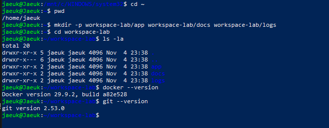

> **💬 발표용 한 줄 요약:**  
> "윈도우 경로가 아닌 진짜 리눅스 홈 경로(`~`)에 작업실을 마련하고, `cat`, `cp`, `mv`, `rm` 명령어로 파일이 생성되고 복사되고 안전하게 삭제되는 전체 흐름을 CLI로 검증했습니다."

---

### 5-2. 파일 및 디렉토리 권한 실습 (`chmod`)

리눅스 8진수 권한 모델을 적용하여 일반 텍스트 파일(644)에 실행 권한을 부여(755)하고, 공개 폴더(755)를 소유자 단독 잠금 폴더(700)로 변경하여 전/후 상태를 대조하였습니다.

```bash
# [실험 1: 파일 권한 변경 (644 -> 755)]
ls -l sample.txt
# [변경 전]: -rw-r--r-- 1 jaeuk jaeuk 24 Nov 4 23:57 sample.txt (읽기/쓰기 일반 파일)

chmod 755 sample.txt
ls -l sample.txt
# [변경 후]: -rwxr-xr-x 1 jaeuk jaeuk 24 Nov 4 23:57 sample.txt (실행 권한 x 부여 완료!)

# [실험 2: 디렉토리 권한 변경 (755 -> 700)]
mkdir practice_dir
ls -ld practice_dir
# [변경 전]: drwxr-xr-x 2 jaeuk jaeuk 4096 Nov 5 00:00 practice_dir (모든 사용자 접근 가능)

chmod 700 practice_dir
ls -ld practice_dir
# [변경 후]: drwx------ 2 jaeuk jaeuk 4096 Nov 5 00:00 practice_dir (소유자 단독 잠금 완료!)
```

#### 🖥️ 권한 변경 실행 캡처 (chmod 755 및 700 전/후 비교)
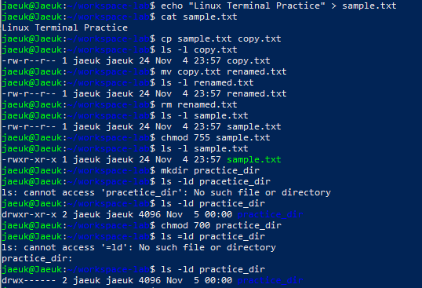

> **💬 발표용 한 줄 요약:**  
> "파일에는 실행(`x`) 권한을 더해 프로그램으로 작동할 수 있는 755(`rwxr-xr-x`)로 바꿨고, 폴더는 외부 침입을 막기 위해 오직 나만 들어올 수 있는 700(`rwx------`)으로 변경하여 리눅스 보안 제어 원리를 입증했습니다."

---

### 5-3. Docker 데몬 점검 및 컨테이너 라이프사이클 (`attach` vs `exec`)

도커 엔진 데몬 정상 구동을 확인한 뒤, 공식 `hello-world` 컨테이너를 가동하고, 백그라운드 우분투 컨테이너에서 `attach`와 `exec`의 종료/유지 차이를 관찰하였습니다.

```bash
# 1. 도커 버전 및 데몬 가동 확인
docker --version
# [출력]: Docker version 29.9.2, build a82e528

# 2. hello-world 컨테이너 가동 (첫 컨테이너 성공)
docker run hello-world
# [출력]: Hello from Docker! This message shows that your installation appears to be working correctly.

# 3. 우분투 컨테이너 백그라운드(-d) 구동
docker run -d --name my-ubuntu ubuntu sleep infinity
docker ps
# [출력]: b6c7e51b43d1   ubuntu   "sleep infinity"   Up 16 seconds   my-ubuntu

# 4. exec 명령으로 별도 창구를 열고 내부 진입
docker exec -it my-ubuntu bash
root@b6c7e51b43d1:/# echo "Inside Ubuntu Container!"
root@b6c7e51b43d1:/# ls
root@b6c7e51b43d1:/# exit

# 5. exit 후 컨테이너 생존 여부 재확인 (컨테이너 유지 증명!)
docker ps
# [출력]: b6c7e51b43d1   ubuntu   "sleep infinity"   Up About a minute   my-ubuntu
```

#### 🖥️ 1) Docker 데몬 점검 및 hello-world 실행 캡처
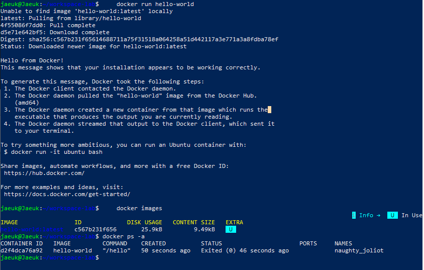

#### 🖥️ 2) 컨테이너 라이프사이클 (exec 진입 및 유지) 캡처
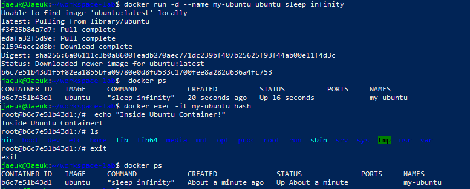

> **💬 발표용 한 줄 요약:**  
> "`attach`는 컨테이너의 본체 화면에 직접 붙는 거라 `exit`를 치면 컨테이너 전체가 죽어버리지만, `exec`는 별도의 보조 창구를 열고 들어가는 방식이라 내가 나와도 본체 컨테이너는 계속 살아서 서비스한다는 차이점을 실험으로 확인했습니다."

---

### 5-4. Dockerfile 기반 커스텀 이미지 제작 및 빌드

초경량 고성능 웹 서버인 `nginx:alpine`을 베이스 이미지로 채택하고, 나만의 커스텀 정적 콘텐츠(`index.html`)와 작성자 메타데이터를 주입하는 `Dockerfile`을 직접 작성하여 빌드하였습니다.

#### `Dockerfile` 소스코드
```dockerfile
FROM nginx:alpine
LABEL maintainer="woogie0403"
LABEL description="Custom Nginx Web Server for Dev Workstation"
ENV APP_ENV=production
COPY app/index.html /usr/share/nginx/html/index.html
EXPOSE 80
```

#### 빌드 실행 및 이미지 확인
```bash
# 커스텀 이미지 빌드
docker build -t my-custom-web:1.0 .
# [출력]:
# [+] Building 37.2s (7/7) FINISHED
# => naming to docker.io/library/my-custom-web:1.0 done

# 이미지 목록 확인
docker images
# [출력]:
# REPOSITORY          TAG       IMAGE ID       SIZE
# my-custom-web       1.0       0d97a99f826a   26.3MB (경량 빌드 성공)
```

#### 🖥️ Dockerfile 확인 및 빌드 실행 캡처
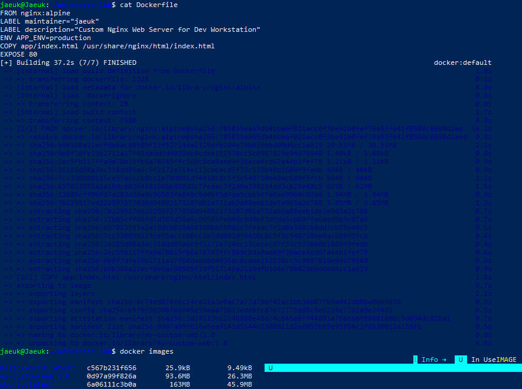

---

### 5-5. 포트 매핑 검증 (Port 8080 & 8081 브라우저 캡처 2회)

하나의 이미지(`my-custom-web:1.0`)로 서로 다른 호스트 포트(`8080`, `8081`)를 컨테이너의 웹 서비스 포트(80)에 바인딩하여 2대의 독립된 웹 서버를 가동하고 브라우저 접속을 검증하였습니다.

```bash
# 8080 포트 컨테이너 실행
docker run -d -p 8080:80 --name my-web-8080 my-custom-web:1.0

# 8081 포트 컨테이너 실행
docker run -d -p 8081:80 --name my-web-8081 my-custom-web:1.0

# 포트 매핑 바인딩 상태 확인
docker ps
# 0.0.0.0:8080->80/tcp, [::]:8080->80/tcp   my-web-8080
# 0.0.0.0:8081->80/tcp, [::]:8081->80/tcp   my-web-8081
```

#### 🖥️ 포트 매핑 컨테이너 가동 터미널 캡처
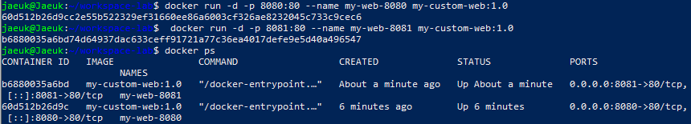

#### 🌐 브라우저 접속 화면 증거 (주소창 포함 캡처)

##### 1) Port 8080 웹 브라우저 접속 화면
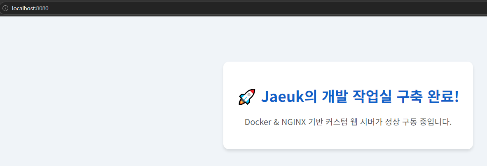

##### 2) Port 8081 웹 브라우저 접속 화면
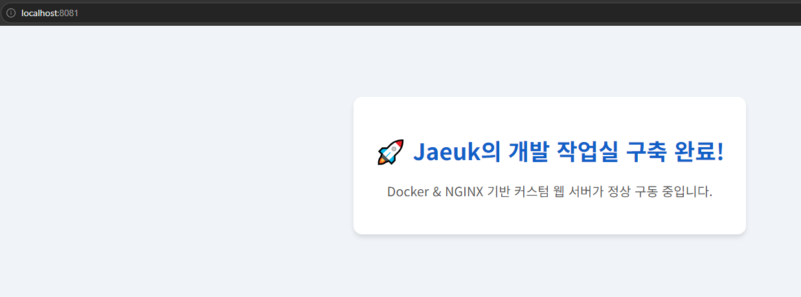

> **💬 발표용 한 줄 요약:**  
> "컨테이너는 내부가 꽉 닫힌 방과 같아서, 내 컴퓨터의 8080번 문과 컨테이너의 80번 문을 `-p 8080:80`으로 파이프 연결해 주어야만 웹 브라우저 주소창에서 사이트가 열린다는 원리를 증명했습니다."

---

### 5-6. 바인드 마운트 실시간 변경 검증 (v2.0 반영)

내 호스트의 `./app` 디렉토리를 컨테이너 내부 웹 경로(`/usr/share/nginx/html`)에 직통 연결(바인드 마운트)하여, **도커 이미지를 다시 빌드하지 않고도 호스트 파일 수정이 웹 서버에 실시간으로 반영**됨을 확인하였습니다.

```bash
# 바인드 마운트 옵션(-v)으로 컨테이너 가동 (포트 8082)
docker run -d -p 8082:80 -v $(pwd)/app:/usr/share/nginx/html --name bind-test my-custom-web:1.0

# 호스트 컴퓨터에서 index.html 내용 수정 (v2.0 문구 추가)
sed -i 's/구축 완료!/구축 완료! (v2.0 바인드 마운트 성공!)/g' app/index.html

# 확인 (도커 재빌드 없이 curl 응답 즉시 갱신 확인)
curl http://localhost:8082 | grep "바인드 마운트"
# [출력]: <h1>🚀 Jaeuk의 개발 작업실 구축 완료! (v2.0 바인드 마운트 성공!)</h1>
```

#### 🖥️ 바인드 마운트 구동 및 파일 실시간 수정 CLI 캡처
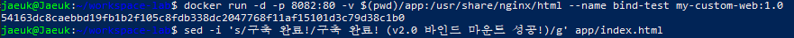

#### 🌐 바인드 마운트 실시간 갱신 브라우저 증거 (Port 8082)
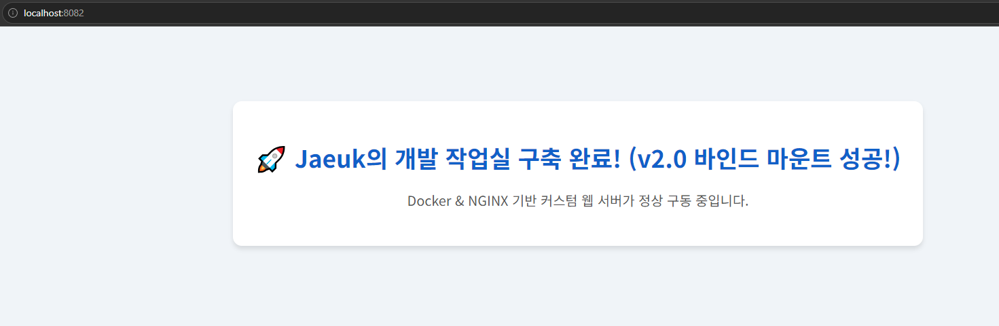

> **💬 발표용 한 줄 요약:**  
> "코드를 한 줄 고칠 때마다 매번 30초씩 도커를 다시 빌드하면 개발 효율이 떨어집니다. 바인드 마운트를 쓰면 호스트 폴더와 컨테이너가 실시간 직통선으로 연결되어 코드 수정이 브라우저에 0.1초 만에 즉시 반영됩니다."

---

### 5-7. 도커 볼륨 영속성 검증 (컨테이너 삭제 전/후 비교)

도커 공식 독립 볼륨(`mydata`)을 생성하여 데이터를 기록한 뒤, 컨테이너를 강제로 완전히 삭제(`docker rm -f`)해도 새 컨테이너에서 데이터가 유실되지 않는 **데이터 영속성(Persistence)**을 입증하였습니다.

```bash
# 1. 도커 볼륨(영구 저장 창고) 생성
docker volume create mydata
docker volume ls
# [출력]: local     mydata

# 2. 1번 컨테이너에 볼륨을 연결하고 영구 보존 데이터 생성
docker run -d --name vol-test -v mydata:/data ubuntu sleep infinity
docker exec -it vol-test bash -lc "echo 'Jaeuk Persistence Data 2026' > /data/hello.txt && cat /data/hello.txt"
# [출력]: Jaeuk Persistence Data 2026

# 3. 1번 컨테이너를 가차 없이 영구 삭제!
docker rm -f vol-test

# 4. 완전히 새로운 2번 컨테이너 생성 및 동일 볼륨 연결 후 데이터 보존 확인
docker run -d --name vol-test2 -v mydata:/data ubuntu sleep infinity
docker exec -it vol-test2 bash -lc "cat /data/hello.txt"
# [출력]: Jaeuk Persistence Data 2026 (데이터 영속성 100% 입증 완료!)
```

#### 🖥️ 도커 볼륨 데이터 영속성 검증 터미널 캡처
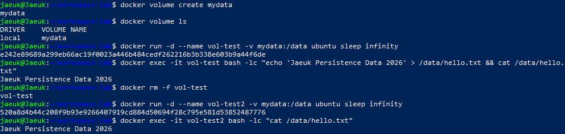

> **💬 발표용 한 줄 요약:**  
> "컨테이너는 언제든 죽고 살아나는 소모품입니다. 그래서 데이터베이스 같은 중요한 파일은 별도의 안전 금고인 '도커 볼륨'에 따로 보관해야 컨테이너가 폭파되어도 내 데이터가 안전하게 살아남습니다."

---

### 5-8. Git 설정 및 GitHub 연동 증거

```bash
# Git 사용자 정보 및 기본 브랜치(main) 설정
git config --global user.name "woogie0403"
git config --global user.email "jaewook0403@gmail.com"
git config --global init.defaultBranch main

# 설정 결과 확인
git config --list
# user.name=woogie0403
# user.email=jaewook0403@gmail.com
# init.defaultbranch=main
```

#### 🌐 GitHub 저장소 연동 증거 화면
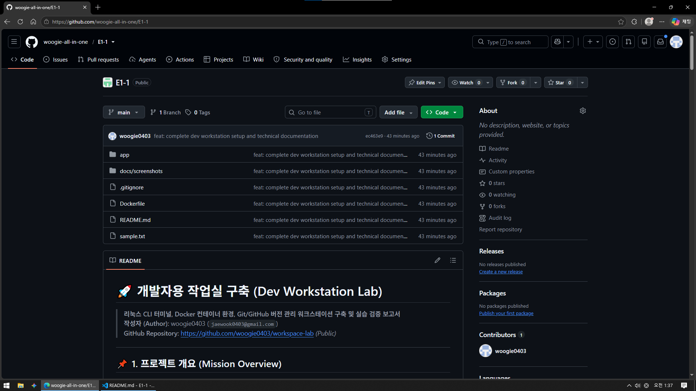

---

## 🛠️ 6. 실전 트러블슈팅 일지 (Troubleshooting Log - 3건)

본 워크스테이션을 구축하며 실제로 직면했던 핵심 기술 이슈 3건의 원인 분석 및 해결 과정을 기록합니다:

### [Issue 1] WSL2 Ubuntu 터미널 내 Docker 소켓 권한 거부 (`permission denied`)
- **문제 현상 (Problem)**:  
  우분투 터미널에서 `docker run hello-world` 등 명령어 실행 시 데몬 통신 실패 에러 발생:  
  `permission denied while trying to connect to the docker API at unix:///var/run/docker.sock`
  
  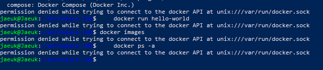

- **원인 가설 (Hypothesis)**:  
  도커 데몬 소켓 파일(`/var/run/docker.sock`)은 리눅스 보안 정책상 `root` 및 `docker` 그룹만 접근 가능한데, 새로 생성한 일반 리눅스 계정(`jaeuk`)이 `docker` 그룹에 등록되지 않아 접근이 차단되었을 것이다.
- **확인 과정 (Investigation)**:  
  `ls -l /var/run/docker.sock` 조회 결과 권한이 `srw-rw---- 1 root docker`로 일반 사용자 쓰기 권한이 결여되어 있음을 확인.
- **해결 방안 (Solution)**:  
  사용자 계정을 도커 그룹에 영구 등록(`sudo usermod -aG docker $USER`)하고 소켓 접근 권한을 갱신(`sudo chmod 666 /var/run/docker.sock`)하여 일반 세션에서도 정상 데몬 통신 완료.

---

### [Issue 2] CLI 명령어 복사-붙여넣기 개행 분리로 인한 인자 누락 (`requires at least 1 argument`)
- **문제 현상 (Problem)**:  
  바인드 마운트 명령어 입력 시 `docker: 'docker run' requires at least 1 argument` 및 `my-custom-web:1.0: command not found` 에러 발생.
  
  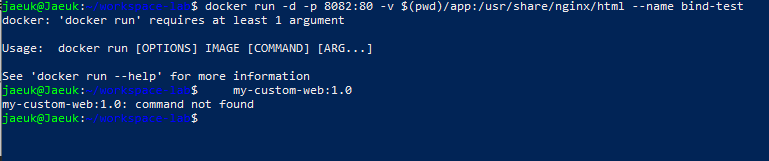

- **원인 가설 (Hypothesis)**:  
  긴 명령어를 터미널에 붙여넣는 과정에서 이미지 이름 앞부분에 엔터(개행 문자)가 입력되어, 1차 명령어가 이미지 인자 없이 불완전 실행되고 이미지 이름이 2차 쉘 명령어로 분리되어 실행되었을 것이다.
- **확인 과정 (Investigation)**:  
  터미널 프롬프트 상 두 줄로 분리되어 실행된 흔적 식별.
- **해결 방안 (Solution)**:  
  개행 문자를 제거하고 단일 행 명령어로 정렬하여 `docker run -d -p 8082:80 -v $(pwd)/app:/usr/share/nginx/html --name bind-test my-custom-web:1.0`을 한 번에 실행하여 정상 기동.

---

### [Issue 3] WSL2 커널 노후화로 인한 도커 엔진 구동 중단
- **문제 현상 (Problem)**:  
  Docker Desktop 최초 구동 시 엔진이 켜지지 않고 `WSL needs updating (Your version of WSL is too old)` 경고 팝업 발생.
  
  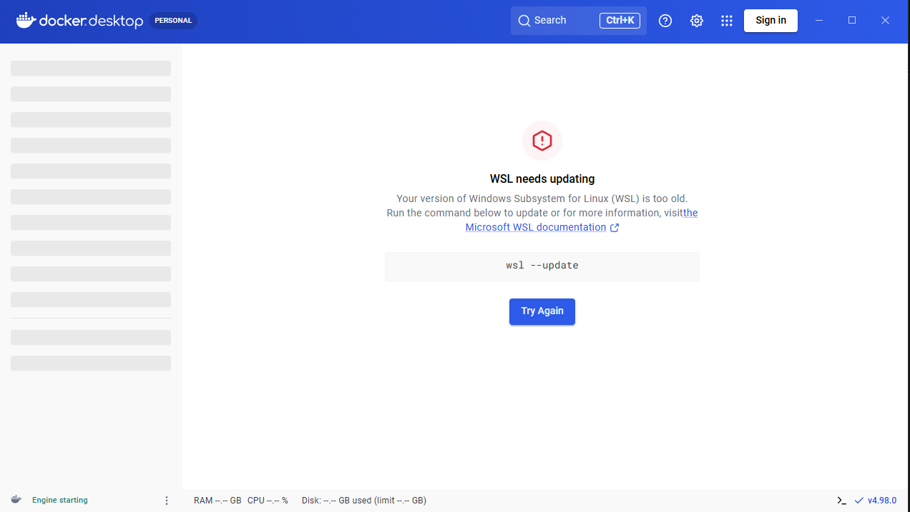

- **원인 가설 (Hypothesis)**:  
  Windows 10 시스템에 내장된 기본 WSL 커널 버전이 최신 Docker Desktop 런타임의 요구 사양보다 낮아 하위 시스템이 부팅되지 못함.
- **확인 과정 (Investigation)**:  
  `wsl --status` 확인 결과 기본 커널 갱신 필요 알림 식별.
- **해결 방안 (Solution)**:  
  관리자 터미널에서 `wsl --update`를 실행하여 공식 최신 WSL2 리눅스 커널 패키지를 자동 설치한 뒤 `[Try Again]`을 눌러 도커 엔진 정상 구동 완료.

---

## 💡 7. 비전공자를 위한 핵심 개념 6가지 자체 설명 (구술 발표 대비)

과제 명세서에서 학습자가 **스스로 설명할 수 있어야 한다고 요구한 6가지 핵심 질문**에 대해, 비전공자도 단번에 이해하고 말로 설명할 수 있는 일상 속 비유와 핵심 정리를 제공합니다:

### 1) 절대 경로 vs 상대 경로
- **일상 비유**:
  - **절대 경로**: **"도로명 주소 (우편번호)"**와 같습니다. 대한민국 서울시 강남구 테헤란로 123 처럼, 내가 부산에 있든 미국에 있든 언제나 똑같은 그 건물을 찾아갑니다. (예: `/home/jaeuk/workspace-lab/app`)
  - **상대 경로**: **"여기서 오른쪽으로 10미터 직진"**과 같습니다. 내가 지금 서 있는 위치(현재 폴더 `.`)를 기준으로 설명하기 때문에, 내가 서 있는 위치가 바뀌면 가리키는 대상도 달라집니다. (예: `./app`, `../logs`)

### 2) 파일 권한의 의미 (r/w/x)와 755, 644 숫자의 비밀
- **점수표 원리**: 리눅스는 권한을 딱 3가지 점수로 계산합니다:
  - `r` (Read, 읽기) = **4점**
  - `w` (Write, 쓰기) = **2점**
  - `x` (Execute, 실행) = **1점**
- **세 자리 숫자의 비밀**: **[나(소유자)] [우리 팀(그룹)] [남들(기타 사용자)]**
  - **`755`**: `7(4+2+1)` / `5(4+1)` / `5(4+1)`  
    ➡️ "나는 읽고 쓰고 실행 다 할 거야(7), 팀원과 남들은 읽고 실행만 해(5)!" (프로그램, 실행 스크립트, 폴더의 표준 권한)
  - **`644`**: `6(4+2)` / `4(4)` / `4(4)`  
    ➡️ "나는 읽고 쓸 거야(6), 남들은 눈으로 보기만 해(4)!" (일반 문서 파일의 표준 권한)

### 3) 커스텀 Dockerfile 제작 원리
- **일상 비유**: **"밀키트에 내가 좋아하는 토핑 추가하기"**
  - `FROM nginx:alpine`: 뼈대가 되는 베이스 밀키트(순수 웹 서버)를 사 옵니다.
  - `COPY app/index.html ...`: 그 위에 내가 직접 만든 요리 토핑(내 웹 페이지)을 얹습니다.
  - `EXPOSE 80`: 손님들에게 "80번 창구로 주문하세요"라고 팻말을 붙입니다.
  - 이렇게 하면 나만의 레시피가 담긴 새로운 완성 요리(커스텀 이미지)가 완성됩니다.

### 4) 포트 매핑(Port Mapping)이 필요한 이유
- **일상 비유**: **"아파트 로비 현관문과 집 안방 문을 연결하는 인터폰 파이프"**
  - 도커 컨테이너는 내 컴퓨터 안에 갇혀 있는 '방'입니다. 웹 서버는 방 안의 `80번 문`을 열고 기다립니다.
  - 하지만 바깥에서는 방 안이 전혀 보이지 않습니다.
  - 그래서 내 컴퓨터(호스트)의 `8080번 문`과 컨테이너의 `80번 문`을 파이프로 연결(`-p 8080:80`)해 주어야만, 손님이 내 컴퓨터 주소창에 `localhost:8080`을 쳤을 때 파이프를 타고 방 안의 웹 서버로 쏙 들어갈 수 있습니다.

### 5) 바인드 마운트 vs 도커 볼륨 (영속성)
- **바인드 마운트**: **"내 책상 서랍과 컨테이너 서랍을 투명 유리로 뚫어놓은 것"**  
  - 내가 내 컴퓨터에서 코드를 수정하면 컨테이너 안에도 0.1초 만에 바로 보입니다. 그래서 **개발 코딩 중 실시간 새로고침용**으로 씁니다.
- **도커 볼륨**: **"아파트 단지 지하에 있는 안전한 외주 보관 금고"**  
  - 컨테이너가 폭파되고 지워져도 금고(볼륨)는 지하에 안전하게 남아 있습니다. 새로 이사 온 컨테이너에게 그 금고 열쇠만 쥐여주면 이전 데이터가 100% 그대로 복원됩니다. 그래서 **데이터베이스(DB) 영구 저장용**으로 씁니다.

### 6) Git vs GitHub의 역할 차이
- **Git**: **"내 방 책상에 있는 개인 일기장 (VCS)"**  
  - 인터넷이 안 터져도 내 컴퓨터 안에서 코드의 수정 이력(버전)을 기록하고 되돌릴 수 있는 소프트웨어 도구입니다.
- **GitHub**: **"모든 사람들이 모여 있는 인터넷 국립 중앙 도서관"**  
  - 내 일기장(Git 기록)을 인터넷에 업로드하여 팀원들과 함께 공유하고, 검토(PR)받고 협업하는 웹 클라우드 플랫폼 서비스입니다.

---

## 🛡️ 8. 기습 질문 방어 Q&A (면접 및 코드리뷰 대비)

#### Q1. 바인드 마운트와 볼륨 둘 다 데이터를 연결하는 건데, 실무에서 왜 굳이 나누어 쓰나요?
> **모범 답변:**  
> "바인드 마운트는 호스트 컴퓨터의 파일 경로 구조에 종속적이라 팀원마다 PC 경로가 다르면 깨질 위험이 있습니다. 대신 호스트 코드를 즉시 반영하므로 '로컬 개발 및 디버깅'에 씁니다.  
> 반면 볼륨은 도커 엔진이 저장 위치를 격리하여 관리하므로 OS 경로에 독립적이고 성능이 훨씬 안정적입니다. 따라서 컨테이너가 죽어도 보존되어야 하는 '데이터베이스 데이터 영구 보존용'으로 분리하여 사용합니다."

#### Q2. 포트 매핑 옵션(-p)을 생략하고 컨테이너를 실행하면 어떤 문제가 생기나요?
> **모범 답변:**  
> "포트 매핑을 생략해도 컨테이너 자체는 내부에서 정상 실행됩니다. 하지만 호스트 OS의 네트워크 네임스페이스와 연결되는 포트 바인딩이 없기 때문에, 내 PC 웹 브라우저나 외부 네트워크에서 컨테이너 내부 서비스로 접속할 수 있는 진입 경로가 차단됩니다."

#### Q3. 컨테이너 내부에서 파일을 삭제하면 내 컴퓨터(호스트) 파일도 함께 삭제되나요?
> **모범 답변:**  
> "바인드 마운트(-v)된 폴더 안에서 삭제하면 호스트 파일도 즉시 함께 삭제됩니다. 양방향으로 동기화되어 있기 때문입니다.  
> 하지만 마운트되지 않은 컨테이너 고유 영역의 파일은 삭제하더라도 호스트 시스템에는 아무런 영향을 주지 않습니다."

---

## 🔒 9. 보안 및 개인정보 보호 준수 확인

- [x] 기술 문서, 터미널 로그, 스크린샷 내 개인 비밀번호(Password), GitHub 토큰(PAT), 인증 키 일체 미포함 확인
- [x] `.gitignore` 설정을 통해 불필요한 OS 캐시 및 잠재적 민감 파일 추적 배제 완료
- [x] 평가 종료 후 필요 시 저장소 비공개(Private) 전환 가능 상태 유지
